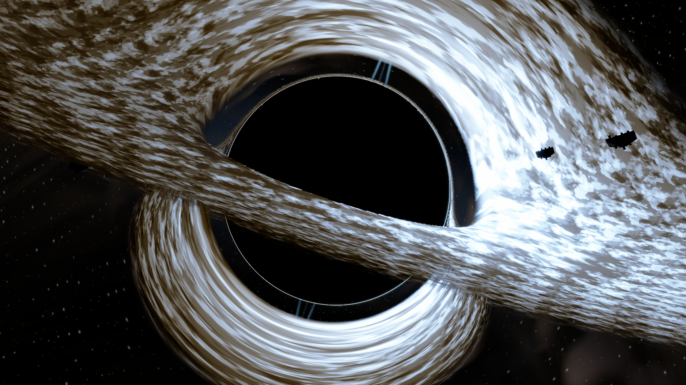

# 末地巨型 Kerr 黑洞

末地天空以倾斜巨型吸积盘和黑洞阴影为中心。黑洞沿负 X 方向、仰角约 23°，从主岛东侧面向主岛时位于其背后；地表照明与阴影投射共用同一个方向。主岛与黑曜石柱在游戏中沿用真实场景几何。天空中的独立尘环与 66 个旧轨道天体退出绘制，七座远景浮岛缩小，作为暗色陪衬。

## 画面

- 阴影角半径约 17.74°（`atan(0.32)`），外盘角直径约 118°，盘面向右下倾斜 18°。天空与照明缓存共用尺度、倾角及盘面坐标系。
- 默认视觉自旋参数为 0.94，阴影有轻微偏移与轮廓不对称，近场透镜带有衰减的方位偏转。
- 预计算光路直接与有限厚度的盘面求交，最先进入的表面遮住后续交会，上下表面法线参与临边暗化。生成器和运行时共用厚度函数，替代此前偏移一份暗盘的做法。轨道角速度随半径变化，流体图样平滑更新。
- 盘面细节在盘平面的笛卡尔坐标中生成有限涡团，再随差速旋转拉成短弧；使用连续的物质流动相位，不再每 12 秒交叉混合两份盘面图样；角速度函数的系数为 0.0475。细节包含连续热底层、密度起伏、局部亮片与两处轨道热点；内层不透明，外侧稀薄部分按密度减弱覆盖。每个动画相位仍读取三次流场纹理，过密细节依据盘面映射逐渐消退。
- 光路数据提供发射处的局部出射方向，结合自旋 0.94 的赤道 Kerr lapse、拖拽角速度和圆轨道速度计算近似频移因子 `g`。色温乘 `g`，总辐射强度乘 `g⁴`，接近侧冷白而明亮，远离侧更暖更暗。
- 盘面辐射尺度维持 2.2。三个波长的黑体近似先以 6500 K 校准白点，消除原始采样使温暖区域也偏蓝的问题；盘面再围绕亮度扩大色差。冷蓝亮侧与暖色暗侧来自局部频移叠加显示处理；白点和色差扩展不代表额外物理频移。
- 盘面通量使用 `F(r) ∝ r⁻³(1−√(Rin/r))`，温度使用 `T ∝ F¼`；最热区位于约 `1.36 Rin`，最内边界渐暗，外盘逐渐冷却。两个局部热点随盘旋转、被差速拉成长弧并平滑消散，同时改变温度和辐射量。
- 上方宽透镜像和下方盘面像来自实际交会数据；图谱插值拒绝跨越不连续表面分支的坐标，减少厚盘边缘虚构的亮丝。
- 图谱分支使用对应的像素覆盖率，后层覆盖率按可见部分归一化；生成方向纹理时，先将发光后层的方向延伸到相邻透明边界，再缩小纹理。避免盘面交会次序切换时产生虚假的频移暗线，纹理尺寸和运行时读取数量不变。
- 光子环在主画面使用全分辨率绘制，遵循盘面和浮岛遮挡；反射路径直接合成同一轮廓。
- 星点使用近场透镜映射和像素导数处理各向异性采样。此前压到几乎不可见的银河带及 `END_NEBULA` 开关已经删除。
- 内盘热冕与外盘盘风共用四个有界体积采样，参与发光、吸收和前后遮挡。盘风缓慢外流、旋转，包含疏密结构；热冕只保留低强度微光。
- 体积单元在盘面深度处分配到前后两侧，避免整个单元突然切换遮挡顺序；保持四个采样位置，增加少量透射率计算。
- 极向喷流包含细中心束、根部鞘层、两个驻留收束亮结和两个向外移动并消散的亮结，下侧较弱，盘面可以遮住根部。

## 地表与空间照明

`lib/end_surface.glsl` 提供共享的冷色盘光、较弱环境光和 GGX 高光。`end_lighting` 去掉原来的方向混合夹限与平方根提亮，受光面、背光面及柱体投影重新保持明显层次。阴影投射、漫反射与高光共用负 X、仰角 23° 的方向；这仍是扩展吸积盘的集中光源近似，并非完整面积光积分。

末地石保持粗糙反射，并由材质编号 11 添加受限的黄绿色自发光；独立泛光源通过末地 `colortex3.a` 传递，不靠提高整个表面的亮度跨过白色阈值。沙子不会进入这条路径。黑曜石使用独立的 `faceData` 第 22 位标记，原四位材质分类与法线不变。表面纹理控制粗糙度，高光使用材质法线和同一份阴影可见度。2026-09-25 已移除按每格方块坐标制造的微小倒角，因为它会强调相邻共面方块的内部接缝；真实外轮廓倒角尚未实现。背向光源的柱面不会被画上无条件的发光轮廓。

照明缓存遮挡会同时衰减冷色直射与高光；环境光、方块光及发光材质仍独立。没有新增反射追踪、阴影贴图或渲染目标。末地泛光采集新增材质遮罩与深度读取，以隔开低强度自发光和普通表面高光。侧向表面为棱边反光读取必要阴影，盘面增加了少量三角函数和外层透明度计算；未取得游戏帧时间数据，不能声称整轮修改零开销。

## 开销与近似

这是面向画面的 Kerr 视觉近似：静态光路由中心引力近似离线积分，再施加轻微自旋轮廓偏移及近场背景偏转；不声称是完整 Kerr 测地线解。运行时使用预计算纹理，替代原来的逐像素光路循环。天空沿用 0.75 倍宽高缓冲，星点与光子环在全分辨率合成；被遮住的背景跳过生成。发光色温使用三个波长采样。光照遮挡从 256 个盘面采样缩减到 32 个，只考虑保留的七座浮岛。

三张自行生成的数据纹理：2048² 双交会坐标、1024² 局部出射方向与表面标记、512² 周期流场。RGBA8 基础纹理存储合计 21 MiB，其中本轮方向数据增加 4 MiB。没有新增游戏渲染目标或时间历史缓冲。当前没有本轮游戏帧率数据。

浮岛先求交，遮住的黑洞天空停止计算；完全遮挡的后层盘面不再采样，只有确有交会的位置读取发射方向。盘面光照缓存的七座浮岛在 32 次采样循环外生成一次。

物理范围：中心引力光路与局部 Kerr 频移并非完整一致的 Kerr 传输；`Rin=0.95` 是视觉截断半径，不是真实 ISCO。通量规律没有完整广义相对论修正，色温尺度、可见热冕和喷流配色经过画面调节，没有模拟磁流体或光行时差。

物理方向参考：[NASA 黑洞可视化](https://www.nasa.gov/universe/nasa-visualization-shows-a-black-holes-warped-world/)、[NASA 热冕研究](https://www.nasa.gov/universe/nasa-led-study-explains-decades-of-black-hole-observations/)、[RAPTOR 相对论传输论文](https://www.aanda.org/component/article?access=doi&doi=10.1051%2F0004-6361%2F201732149&mb=0)。热冕主要关联高能辐射，此处可见微光是视觉代理；没有复制来源中的图像或代码。

盘面包含炽白内层、暖色外层、局部余烬状亮丝。光子环继续在全分辨率绘制；临界曲线附近的高阶图像平滑消退，避免细碎亮点盖住光子环。末地 Bloom 保留局部能量并增加两级微弱外扩。

## 预览与入口

以下图片是此前保存的离线预览，尚未按 2026-09-24 的全部修改重新生成，不能用于确认当前地形、阴影或泛光效果。

上图为 3840×2160、朝向黑洞中心、动画时间 24 秒的独立天空渲染，不含 Minecraft 地形。预览按 0.75 倍天空缓冲、全分辨率星点和光子环合成，并使用 Astra 默认 Uchimura / sRGB 曲线及末地 Bloom 参数。

[主岛构图预览，2400×1350](images/end-island-compose.png)：镜头朝负 X，稍微抬头；吸积盘在主岛和黑曜石柱后方。预览使用简化岛面与方柱，执行共享地表照明函数，并以解析几何绘制投影；它不是 Minecraft 地形截图，未包含游戏材质贴图、PCF 阴影及完整后处理。

[喷流根部和亮结特写，2400×1600](images/end-jet-detail.png) · [较远的喷流特写，1600×1200](images/end-jet-knots.png) · [较宽天空视角，2400×1350](images/end-kerr-wide.png)。喷流特写镜头沿倾斜的自旋轴取景，避免将真实轴线裁在图外。

- `Astra/shaders/global/dimension/end_kerr.glsl`：尺度、自旋、透镜、盘面材质与全分辨率光子环。
- `Astra/shaders/global/dimension/end_blackhole.glsl`：遮挡顺序、二次像、厚盘、喷流与远景浮岛。
- `Astra/shaders/global/dimension/end_system.glsl`：星空。
- `Astra/shaders/program/deferred.fsh`：全分辨率星点和光子环合成。
- `Astra/shaders/program/end_illumination.fsh`：远景缓存与光照遮挡。

- `end_disc_profile.glsl`：生成器与运行时共享的厚度和通量。
- `end_plasma.glsl`：热冕、盘风、喷流结构。
- `qa/tools/build_end_transfer.py`：重建三张原创数据纹理。
- `qa/tools/render_end_design.py`：`--view blackhole|island|jet`、`--foreground` 和 `--aim-offset` 控制预览构图。
