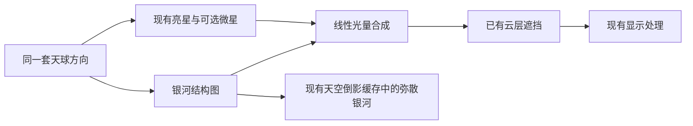

# Astra 夜晚璀璨银河设计方案

接续说明：用户后续要求核验新增规划后开始实施，并强调控制开销。现采用先增强现有程序带、复用原星表的路线；结构贴图方案仍为后续候选。当前实现和代价见[实现与限制](../docs/实现与限制.md)，新增规划的核验结果见[规划第十节](../docs/银河方案规划-2026-10-18.md)。以下保留本次方案比较，不代表这些候选均已实施。

日期：2026-10-17。状态：设计调研，未改天空源码、未制作或接入新素材。用户本轮要求主世界天空之外的性能优化，同时调研银河；两件事独立推进。本文的推荐不是已确定的审美选择，也不代表游戏画面。

## 结论与当前差距

推荐“离线生成的原创银河结构贴图＋现有亮星＋局部微星”的混合方案。把主要成本放在制作阶段，运行时只查询静态银河结构，保留少量程序星点；不为银河增加体积搜索或独立屏幕阶段。整体偏冷白，银河中心稍暖，暗纹要清晰，微星的锐度与弥散光的柔和分开控制。

当前并非没有银河：`Astra/shaders/global/atmosphere/stars.glsl`已有`astra_milky_way`。它与星表共用天球坐标，一次低频噪声形成蓝色宽带，窄核心内部再查一次噪声形成暗纹。该带大致覆盖银道两侧各12.7°，但没有沿带变化的明确中心隆起，也没有独立微星密度。主体颜色较淡、偏蓝，尘埃最多压低本层约一半。现有星点数量独立于银河，两个球面图表在交界处重叠，星点有紧核心与弱光晕。

这些是源码事实，不能单凭数值判断玩家实际看到了多少。旧`SUMMARY-nightsky.md`正文的“主世界无银河”是旧时点描述，不再作为当前缺口。

主世界屏幕天空在`program/deferred.fsh`合成星野，乘本帧云透过比例。水下透过水面的星空由`program/water.glsl`另行求方向和窗口放大。普通天空倒影缓存`program/sky_reflection_cache.fsh`目前只生产大气与云，不含星野或这条银河；不能以为扩充`astra_star_field`后普通水面倒影就会自动出现银河。

## 从一手资料得到的设计依据

| 来源与所读位置 | 能支持什么 | Astra的取舍 |
|---|---|---|
| [ESO银河全天全景](https://www.eso.org/public/images/eso0932a/)及[银河中心与暗尘埃](https://www.eso.org/public/images/milkywaylasilla-cc/) | 银河包含亮度不均的盘、较亮中心、暗纹和发光区域；摄影作品的色彩与曝光是视觉参考 | 借鉴中心隆起、分叉暗纹和冷暖层次。目标可比裸眼观感更璀璨，但不把长曝光照片的亮度说成肉眼标准 |
| Photon本轮读取的[main/sky.glsl](https://github.com/sixthsurge/photon/blob/main/shaders/include/sky/sky.glsl)，`draw_galaxy`、`draw_sky` | 球面经纬度读取银河图，银河与星点共用天球方向，随后处理大气和云；[main/stars.glsl](https://github.com/sixthsurge/photon/blob/main/shaders/include/sky/stars.glsl)按银河亮度调节星点阈值 | 借鉴静态结构图和统一合成。已有Astra星表继续复用；不直接沿用其随亮度变化的星点出现阈值 |
| Solas本地副本`reference_shaderpacks/solas-shader/shaders/lib/atmosphere/milkyWay.glsl`，`drawMilkyWay`；副本未在该文件标明版本 | 纹理银河与附加程序星云分开，银河影响后续星野，倒影另加亮度补偿 | 借鉴分层责任。其贴图随时间平移、倒影额外乘3的方式不直接采用；Astra需要位置稳定、反射由现有水面光学决定 |
| Complementary本轮读取的[main/nightNebula.glsl](https://github.com/ComplementaryDevelopment/ComplementaryReimagined/blob/main/shaders/lib/atmospherics/nightNebula.glsl)，`GetNightNebula`及噪声循环 | 三层彩色场各使用5或8层噪声，带时间变形和嵌入星点；这是程序星云的表现路线 | 可参考颜色层次，不把这一套动态星云当成低成本银河。固定夜空结构不需要持续流动，也不直接复制其实现 |

本地Photon副本另行读取了同名函数，不能将副本行号或旧报告的版本号当作本轮main的发布版本。以上属于结构研究，本轮未搬入第三方源码或素材。

## 三种方案

| 方案 | 视觉结果 | 运行成本与局限 | 适用判断 |
|---|---|---|---|
| 扩充现有纯程序带 | 增加中心隆起、两层暗纹和局部星点，保持全部可调 | 在当前1～2次噪声读取上继续加层；复杂暗纹需要更多读取或运算，结构容易重复 | 改动较集中，适合拒绝新增素材的情况，精细程度受约束 |
| 原创结构贴图＋程序星点 | 能明确设计中心、裂隙、星团和冷暖分布；程序星点保留锐度与微弱闪烁 | 增加静态纹理及球面坐标换算；高档微星另有星表计算，远处需正确过滤 | **推荐。** 可把银河轮廓与运动稳定性分开处理，适合当前性能优先的方向 |
| 摄影全天图＋程序亮星 | 真实结构最直接，较少制作结构的工作 | 成图常自带密集星点、曝光与噪声，容易与程序星点叠加；必须处理接缝、色彩和素材署名 | 可作视觉参考或独立风格，但不直接拿一张有地景的照片贴到天球上 |

## 推荐方案的实际观感

1. **宽的弥散星带。** 轮廓是不均匀的星云团，边缘逐渐融入深色夜空；沿带只有一段较宽、较亮的中心，避免整圈相同粗细和亮度。银河随现有天球转动，玩家走动不会让它平移。
2. **分叉的暗尘埃。** 暗纹像背景星光被遮住，不是额外涂一条黑色裂缝。它压低远处银河及微星，前景亮星可保留，使结构有深浅层次。
3. **密集但较暗的微星。** 固定的第二组候选星表只在银河区域显示，由静态密度调节亮度。夜晚渐入与月光只调整体光量，不重排星表或逐帧改变出现阈值。细到屏幕像素以下的部分逐渐交给弥散光，减少转动时的闪点。
4. **少量较亮的星。** 保留现有暖、白、冷色分布，核心清楚，光晕较弱；大多数星不画十字光芒。银河主体以冷白为主，中心稍暖，少量蓝色和很淡的红色只作局部点缀。

“璀璨”来自亮星、密集微星与暗纹之间的反差。整体曝光、夜间地形亮度、月亮和云的既有规则不随银河强度一并抬高。

## 素材与资源安排

结构图建议从1024×512的RGBA8开始。RGB保存已经包含暗纹的弥散银河颜色；A保存暗纹作用后的远处微星密度。图中不烘入需要保持锐利的前景大星，也不包含地景、月亮或云。RGB的显示颜色与线性光量转换要明确，A始终是普通线性控制值。

本级图像约2 MiB，包含完整逐级缩小图像时约2.67 MiB；2048×1024对应约10.67 MiB。这是未压缩图像的尺寸估算，不是驱动已分配的显存读数。缩小图像让转头、改变视野和低分辨率倒影时有合适的细节尺度。经度接缝需要连续，极区不能用未定义的角度。

制作优先使用原创结构。若选ESO公开素材，应逐图看署名和例外；[ESO使用说明](https://www.eso.org/public/outreach/copyright/)给出的通用许可为CC BY 4.0，要求完整、可见署名并说明修改。素材来源与实际处理在真正接入时登记到THIRD-PARTY；本轮没有下载或加入这些图像。

## 在Astra中的分工和完整过程

晴朗夜晚仰望天空时，先用现有太阳/天球基底确定方向，再查询银河结构，叠加固定星表，随后由现有云层遮挡，最后进入已有曝光、调色与抗锯齿。白天、雨天、失明/黑暗和近地平线的退出范围沿用已确认行为；银河有独立强度，不与STAR_AMOUNT的“关闭全部星野”语义混淆。是否在关闭星点时保留银河需在实际设置设计时明确，不能留下隐藏依赖。

共享的银河函数应返回弥散颜色和微星密度，供屏幕天空、水下折射天空和倒影生产者使用，避免三套方向、色彩和强度。

- **屏幕天空：** 在`program/deferred.fsh`已有天空分支中消费，只有可见天空处理星带。云层不透明时仍提前结束，不把银河盖在云前。
- **普通水面：** 在现有`program/sky_reflection_cache.fsh`的云合成之前加入弥散银河，不在每个水面像素重新生成。仅缓存宽带与大结构；尖锐微星不能直接塞进256×128缓存后宣称与直接天空同样清晰。没有启用这份缓存的云模式，需在现有解析反射后备路径补同一层弥散银河。
- **水下水面：** 沿现有折射方向显示银河，使用已有云透过比例。银河的可见角度受水面窗口放大改变，细节过滤使用放大后的角度范围，不沿空气视角硬贴。
- **抗锯齿：** 微星沿用当前星点的运动隔离；细星不过度交给旧画面累积。宽银河可沿用已有天空历史规则。FXAA/SMAA下也要靠本身的尺度过滤保持稳定。
- **没有纹理或效果关闭：** 由着色器设置关闭新增路径并保留现有星野；新增素材需与包一同提供，不能默默显示缺图颜色。默认流畅档可选不加微星，具体默认观感尚未由用户决定。

## 预计成本与尚未决定的内容

结构图在可见银河范围内约增加一次查询及经纬度转换，范围外先退出；这不是“整套银河只需一次查询”的承诺。开启微星还要增加一套局部星表，沿当前双图表设计通常检查4个格点，交界时可能为8个，并有星点形状、颜色及尺度过滤计算。倒影缓存生产者增加银河结构查询，主水面继续读取缓存；不增加体积搜索和全屏附件。

实际GPU成本未知。不能拿Photon或Solas的成本当作Astra数据，也不能承诺恢复水面100 FPS。采用贴图的好处主要是避免逐像素实时计算复杂银河尘埃，不表示没有显存、带宽和星点计算代价。

目前可直接接续的设计是推荐的混合方案；尚未制作贴图，也未增加设置。用户仍可在自然、璀璨、梦幻三个视觉方向之间取舍。正式实施前需要确定素材与默认强度、是否启用微星、星点总开关与银河开关的关系；这些是审美及使用规则，不由调研报告自动变成已确认要求。
